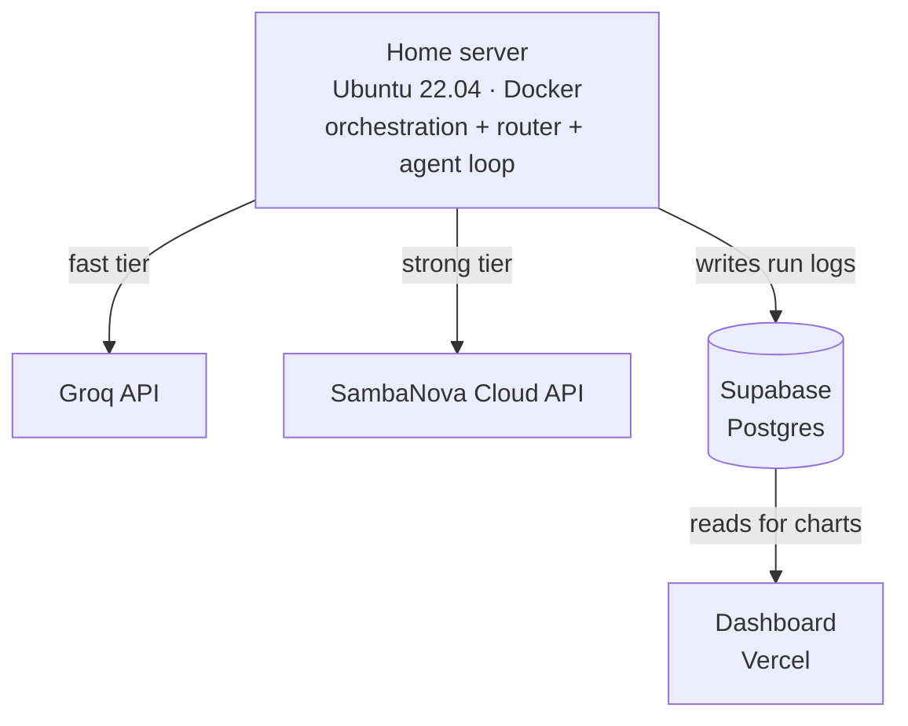

# RouteBench

**Does cost-aware LLM routing hold up under repeated trials?** A router built to cut inference cost, stress-tested inside an agent benchmark to see whether it holds onto its reliability across repeated runs — not just its accuracy on paper.

> Working title — rename freely once you've got a git repo and a personal favorite.

*Last updated: 2026-07-19 · Status: Phase 1 complete — router, cascade, and Pareto frontier analysis all verified end-to-end. Phase 2 (pharmacy agent, pass^k reliability) not yet started.*

---

## 1. Overview

**What this is:** A two-part systems project. Part 1 builds a calibrated, learned router that sends each query to a cheap/fast model or a stronger/slower one based on predicted difficulty, evaluated on the cost-quality-latency tradeoff it achieves. Part 2 takes that router and drops it inside a small tool-using agent, then measures whether routing preserves the agent's **run-to-run reliability** (not just its average accuracy) using a pass^k metric — the probability the agent solves the identical task correctly on every one of *k* independent attempts.

**Why this exists:** The goal is a portfolio project that demonstrates production-systems thinking (cost/latency/quality tradeoffs, reliability under repetition) rather than another retrieval-augmented chatbot. Both halves are grounded in active, current research rather than invented from scratch — see Section 2.

**Who this document is for:**
- **You**, as the source of truth when you've context-switched away and come back.
- **Anyone you show this to** (recruiters, other engineers) as a fast way to understand the project's scope and your reasoning.
- **An AI coding assistant.** Paste or attach this file (plus `PROGRESS.md` for current state) to give it full context before asking for implementation help.

---

## 2. Research Questions

Each question has a metric attached — if you can't measure it, it's not a research question yet, it's a vibe.

| # | Question | Answered by |
|---|---|---|
| **RQ1** | Can a calibrated, learned router approach a strong model's quality at a fraction of its cost? | Cost-quality-latency Pareto frontier vs. always-cheap / always-expensive / random baselines |
| **RQ2** | Does inserting that router into an agent's per-step model choice preserve task reliability, or does the routing decision itself introduce run-to-run inconsistency? | pass^k comparison: always-cheap agent vs. always-expensive agent vs. routed agent |
| **RQ3** *(stretch)* | How sensitive are agent-reliability measurements to which model plays the simulated user? | pass^k recomputed with a swapped simulated-user model |

RQ2 is the actual differentiator — routing papers rarely test whether the *routing decision itself* is stable across repeated trials of the same task, and reliability papers rarely test agents under a non-fixed model. Sitting at that intersection is the point.

---

## 3. System Architecture



| Component | Role | Why this choice |
|---|---|---|
| **Home server** (AMD A6-6310, 4GB RAM, Ubuntu 22.04, Docker) | Runs the router, the agent loop, and the evaluation sweeps. Orchestration only — never hosts a model. | Hardware has no meaningful GPU and 4GB RAM; it's a fine always-on Linux box for I/O-bound orchestration, wrong for model serving. Docker runs natively here with no virtualization needed (BIOS virtualization can stay disabled — Docker on Linux uses kernel namespaces/cgroups, not hardware virtualization). |
| **Groq API** | "Fast" tier in the router/cascade — small, cheap, low-latency model | Genuinely free tier, no card required, fast enough to make multi-sample and cascade strategies cheap in wall-clock time |
| **SambaNova Cloud** | "Strong" tier — larger model, escalation target | Independent free tier with different models/hardware than Groq, giving a real second option rather than two sizes of the same provider |
| **Supabase (Postgres)** | Stores every run: query, route taken, tokens, latency, cost, correctness, task id, trial number | Free tier, plain SQL (no vector store needed this time — no RAG), queryable from both the server and the dashboard |
| **fastembed** | Turns each query into an embedding for the router's feature vector | ONNX-based, no PyTorch — light enough for a 4GB, no-AVX2 CPU |
| **scikit-learn / LightGBM** | The router's actual classifier (logistic regression baseline, optionally a small gradient-boosted tree) | Classical ML, CPU-only, trains in seconds on this hardware — appropriate model complexity for the data volume this project will generate |
| **Vercel dashboard** | Small static/Next.js page reading from Supabase, rendering the Pareto frontier and pass^k comparisons | Free, gives you a live link for the article/LinkedIn post instead of a screenshot |
| **GitHub + GitHub Actions** | Version control; CI runs lint + tests (with API calls mocked) on every push; a scheduled job pings Supabase daily | Keeps the free Supabase project from auto-pausing after a week of inactivity, and catches breakage before you find it manually |

### 3.1 Phase 2 Domain: Retail Pharmacy Inventory & Procurement

Scoped deliberately to **back-office logistics only** — checking stock, comparing suppliers, placing and tracking orders, reconciling counts. Explicitly **not** in scope: prescriptions, dispensing, dosing guidance, drug interactions, patient records, or controlled-substance compliance. This keeps grading fully deterministic (the agent either leaves the database in the correct end state or it doesn't) and sidesteps the much harder problem of clinical accuracy, while still resembling a real small-business tool.

**Mock database (three tables):**
- `inventory(drug_name, current_stock, reorder_threshold, unit_cost)`
- `suppliers(supplier_name, drug_name, price_per_unit, lead_time_days, min_order_qty)`
- `orders(order_id, drug_name, supplier_name, quantity, status, created_at)`

**Tools the agent can call:**
1. `check_inventory(drug_name)` → current stock + reorder threshold
2. `list_suppliers(drug_name)` → price, lead time, minimum order quantity per supplier
3. `place_order(drug_name, supplier_name, quantity)` → creates an order, returns an order id
4. `check_order_status(order_id)` → current status
5. `adjust_stock(drug_name, quantity_delta, reason)` → for reconciling physical counts

**Example tasks** (10-15 total; illustrative subset below, using common non-controlled medications to keep the domain squarely in generic logistics territory):
- *"Amoxicillin is running low — if it's below its reorder threshold, order enough from the cheapest available supplier to bring stock up to 2x the threshold."*
- *"A physical count found only 40 units of insulin, but the system shows 55. Correct the record and log the reason as a cycle-count discrepancy."*
- *"Find the supplier with the fastest lead time for metformin and order 200 units."*
- *"Check the status of order #1042 and report whether it has shipped."*

Each task has a deterministic pass/fail check against the final database state (e.g., task 1 succeeds iff an order exists for amoxicillin, from the cheapest supplier, for exactly `2 × threshold − current_stock` units).

**Honest caveat:** turning this into an actual production tool for a real pharmacy would require integration with a real point-of-sale/inventory system and real controlled-substance regulatory compliance — meaningfully more than this benchmark prototype covers. Worth saying plainly in the article rather than overclaiming.

**Proposed repo layout** (refine once Phase 0 starts):

```
routebench/
├── PROJECT.md, PROGRESS.md, README.md
├── .env.example
├── docker-compose.yml
├── src/
│   ├── router/        # features.py, classifier.py, cascade.py
│   ├── agent/          # tools.py, simulated_user.py, loop.py
│   ├── eval/            # benchmark_router.py, benchmark_agent.py
│   ├── providers/    # groq_client.py, sambanova_client.py
│   └── db/                # supabase_client.py
├── tests/
├── dashboard/        # Next.js app deployed to Vercel
└── notebooks/        # exploratory analysis only — no core logic here
```

---

## 4. Tech Stack

| Layer | Technology | Notes |
|---|---|---|
| Language | Python 3.11 | |
| Dependency management | `uv` + `requirements.txt` (or `pyproject.toml`) | Fast, low-overhead installs — matters more on this CPU than on a dev laptop |
| Model inference | Groq API, SambaNova Cloud API | Exact model names TBD — confirm current free-tier catalog on each console during Phase 0 rather than hardcoding names now |
| Embeddings | fastembed | CPU/ONNX only |
| Classical ML | scikit-learn, optionally LightGBM | Router classifier + calibration (Platt scaling / isotonic regression) |
| Data store | Supabase (Postgres) | Free tier; no pgvector needed this project |
| Containerization | Docker + Docker Compose | Runs on the home server |
| Networking | Cloudflare Tunnel *(only if the dashboard needs to call the home server live; likely unnecessary since the dashboard reads from Supabase, not the server directly)* | |
| Frontend | Next.js on Vercel | Small, mostly static |
| CI/CD | GitHub Actions | Lint + test on push, API calls mocked; scheduled Supabase keep-alive ping |
| Testing | pytest | Unit tests for router logic and scoring; integration tests hit real APIs sparingly to protect free-tier limits |
| AI pair-programming (optional) | Aider or Claude Code | This document is written to be handed to either as project context |

---

## 5. Development Methodology

**Kanban-managed Iterative & Incremental Development (IID).**

- **Iterative & Incremental:** the system is built in small working slices (Phase 1 alone is a complete, demonstrable deliverable), each one tested and evaluated before the next begins, with findings from each iteration allowed to change the plan for the next.
- **Kanban** for day-to-day flow: a visible backlog, an explicit work-in-progress limit, and continuous pull of the next task — no sprint boundaries or standups, because there's no team to synchronize. See `PROGRESS.md` for the live board.
- **Borrowed, not adopted wholesale:** Definition of Ready / Definition of Done checklists (usually a Scrum artifact) and Architecture Decision Records (a lightweight, independently-standard practice for logging *why*, not just *what*) are used without adopting the rest of either framework.
- **Why not Scrum:** sprint ceremony (planning, standups, retros) exists to coordinate a team; solo, it's overhead with no one to coordinate with.
- **Why not Waterfall:** RQ2 in particular has a genuinely unknown answer going in — a rigid up-front spec would have to be rewritten the moment real results come in, which defeats the purpose of a fixed-phase plan.
- **Research hygiene:** each research question gets a logged prediction *before* the experiment runs and a logged result *after* — see the Hypothesis Log in `PROGRESS.md`. This is standard practice in empirical ML work and prevents quietly rationalizing whatever the data happens to show.

---

## 6. Roadmap

| Phase | Goal | Definition of Done |
|---|---|---|
| **0 — Setup** | Repo, infra, credentials, and dataset choice in place | All three APIs (Groq, SambaNova, Supabase) reachable from the home server with a working smoke test; benchmark dataset for Phase 1 finalized |
| **1 — Router** | Calibrated cascade router evaluated against baselines, on a GSM8K + MMLU-style mixed-difficulty benchmark | Pareto frontier plotted (cost/quality/latency) against always-cheap, always-expensive, and random baselines; findings written up in plain language |
| **2 — Agent + Reliability** | Router wired into a tool-using agent operating the Retail Pharmacy Inventory & Procurement domain (§3.1), evaluated on pass^k | pass^k measured for always-cheap / always-expensive / routed agent; RQ2 answered either way |
| **3 — Synthesis** | Public-facing deliverables | Dashboard live on Vercel, repo README polished, technical article and LinkedIn post drafted |

Full task-level breakdown lives in `PROGRESS.md` — this table is intentionally the only place phase status is summarized, so the two documents don't drift out of sync with each other.

---

## 7. Success Criteria

The project is "done enough to publish" when:
- RQ1 and RQ2 both have a logged, plotted answer (even if the answer is "routing doesn't help" — a clean negative result is still a real finding).
- Someone else could clone the repo, follow the README, and reproduce your charts from a fresh environment.
- The article makes a specific, defensible claim backed by your own data, not a general description of what you built.

---

## 8. Risks & Mitigations

| Risk | Mitigation |
|---|---|
| Free-tier rate limits throttle evaluation sweeps | Cache results in Supabase as you go so a sweep can resume instead of restarting; keep benchmark size modest (tens, not thousands, of tasks) |
| Motivation drop / context-switch after a break (this has happened before on this project) | Phase 1 is independently shippable on its own — a partial stop still leaves something real to show |
| API pricing/rate-limit/model-catalog changes mid-project | Model names and limits are treated as Phase 0 configuration, not hardcoded assumptions in this doc |
| Scope creep (adding "just one more" comparison) | New ideas go in the Backlog's "Later / Maybe" section in `PROGRESS.md`, not directly into the active phase |
| 4GB RAM home server gets tight | Everything heavy (model inference) is remote by design; only embeddings and classical ML run locally |

---

## 9. Out of Scope

Explicitly **not** part of this project — worth stating so an AI assistant doesn't propose these by default:
- No local LLM serving or fine-tuning.
- No production-grade auth, multi-tenancy, or horizontal scaling.
- No RAG / vector retrieval.
- No mobile app or browser extension.
- tau-bench's actual retail/airline domains are not reused — a smaller custom domain is built instead (§3.1).
- Within the pharmacy domain specifically: no prescriptions, dispensing, dosing, drug interactions, patient records, or controlled-substance compliance logic — inventory and procurement only (§3.1).

---

## 10. How These Two Documents Work Together

- **`PROJECT.md`** (this file) — stable. The *what, why, and how*. Update it when a real architectural or methodological decision changes, not on every completed task.
- **`PROGRESS.md`** — living. The *where we are right now*: Kanban board, decision log, hypothesis log, dev log. Update it every working session.
- **Handing context to an AI assistant:** share both files. `PROJECT.md` gives the assistant the stable picture; `PROGRESS.md`'s "Current Status" section at the top tells it exactly what's done, in progress, and next — so it doesn't have to reconstruct that from a long chat history.